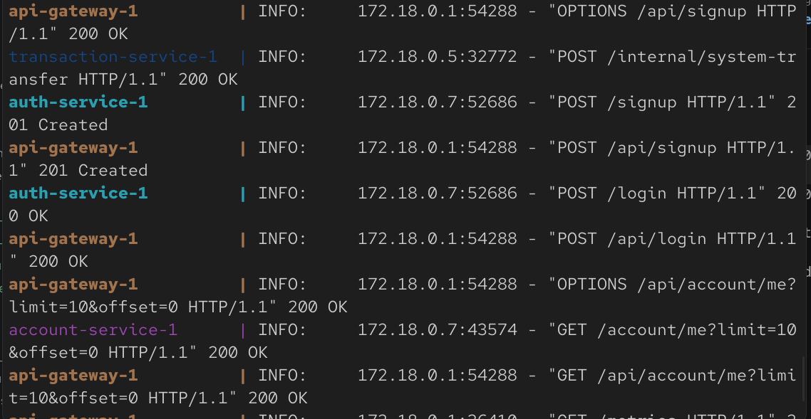
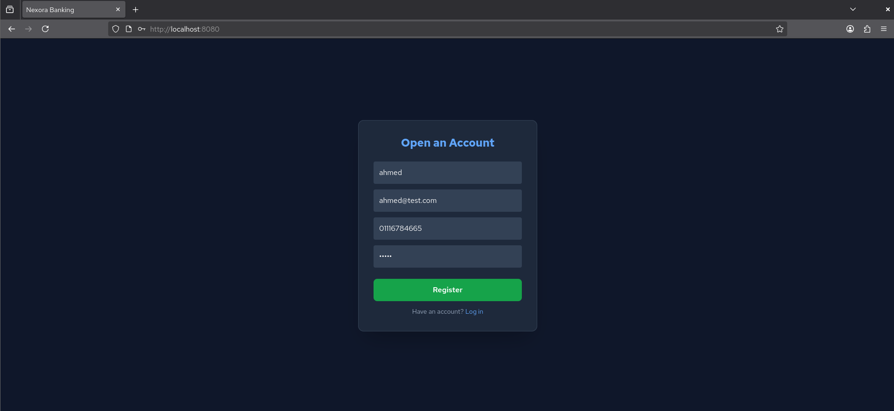
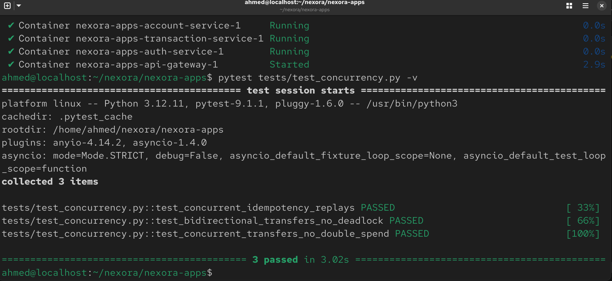
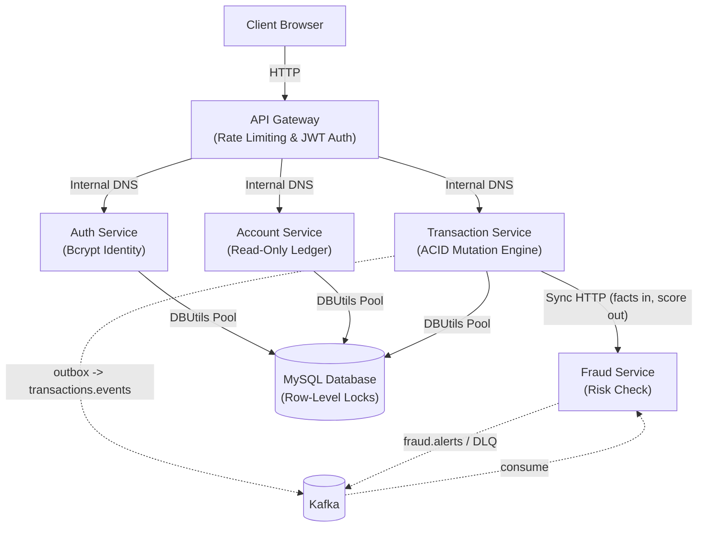
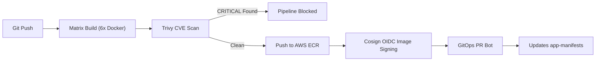
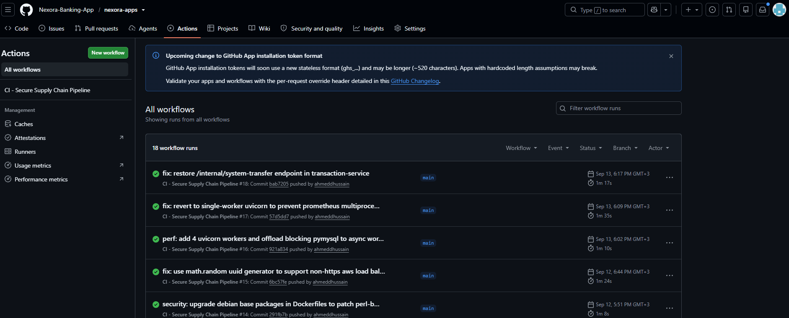
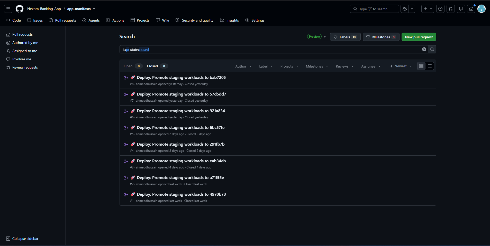
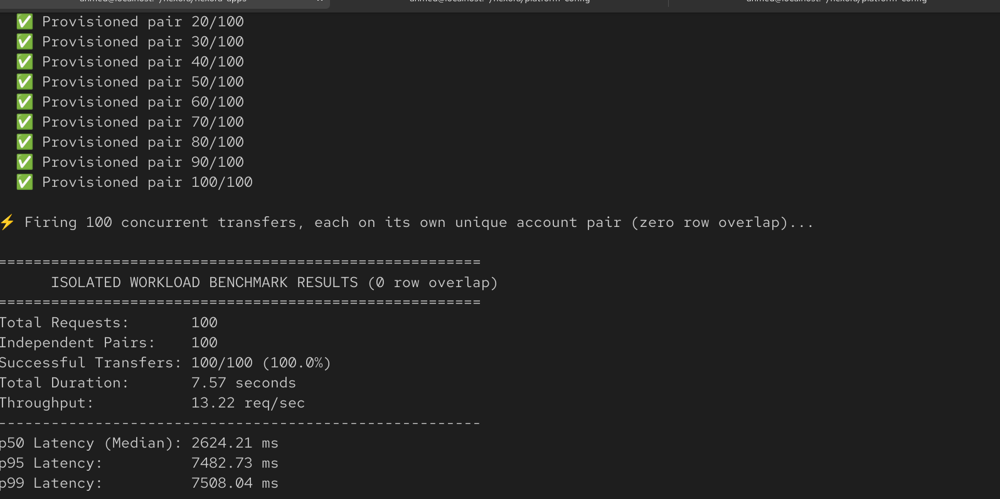
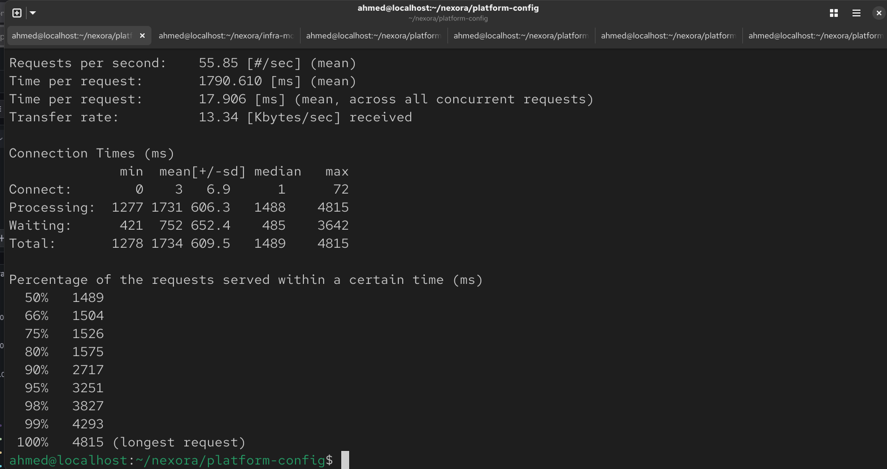

<div align="center">

#  Nexora Core Banking: Workloads & Supply Chain

### Enterprise Microservices & Secure CI/CD Pipeline

**FastAPI • PyMySQL • JWT • Docker • GitHub Actions • Trivy • Cosign • Pytest**

<br>


<br>


<br>

This repository contains the core application workloads and the **Secure Software Supply Chain** for the Nexora Enterprise GitOps Platform. It demonstrates a distributed transaction engine with defensive financial concurrency (Two-Phase Leases & Fencing Tokens), multi-stage Docker builds, and a vulnerability-gated CI pipeline integrated with AWS ECR and Sigstore Cosign.

</div>

---

## At a Glance

**What this repository is:** the source code of the six services, their tests, and the pipeline that turns a merge into scanned, signed images.

| Path | Contents |
|---|---|
| `api-gateway/`, `auth-service/`, `account-service/`, `transaction-service/`, `fraud-service/` | One FastAPI service each: `main.py`, `requirements.txt`, `Dockerfile`, and the shared `nexora_common.py` (JSON logging, correlation IDs) |
| `fraud-service/rules.py` | The fraud rules, free of any framework so they are easy to test |
| `frontend-web/` | Single-page UI and its NGINX configuration |
| `db-init/` | Schema and seed data for local development |
| `tests/unit/` | Fraud rules, API contract and log-format tests; no running stack needed |
| `tests/test_concurrency.py`, `tests/load_benchmark_*.py` | Concurrency suite and load generators; need a running stack |
| `scripts/sync-common.sh` | Keeps `nexora_common.py` identical in every service |
| `docker-compose.yml` | The whole system locally: MySQL, Kafka and the six services |
| `catalog-info.yaml` | Backstage catalog entries |
| `.github/` | `checks.yaml` (pull requests), `ci.yaml` (release), Dependabot |

**What it does not contain:** Kubernetes manifests (`app-manifests`) or platform configuration (`platform-config`).

---

## Table of Contents

1. [Current Staging Deployment](#current-staging-deployment)
2. [Platform Overview](#platform-overview)
3. [Quick Start & Local Development](#quick-start--local-development)
4. [Configuration](#configuration)
5. [Application Architecture & Traffic Flow](#application-architecture--traffic-flow)
6. [Financial Concurrency Engine](#financial-concurrency-engine)
7. [Secure Software Supply Chain (CI)](#secure-software-supply-chain-ci)
8. [System Verification & End-to-End Testing](#system-verification--end-to-end-testing)
9. [Performance Benchmarking & Capacity Planning](#performance-benchmarking--capacity-planning)
10. [Real-World Troubleshooting & Solutions](#real-world-troubleshooting--solutions)

---

## Current Staging Deployment

The live staging environment was verified on **2026-10-06**. This repository supplies
the six application services; Kubernetes deployment settings live in the separate
`app-manifests` and `platform-config` repositories.

| Area | Current staging configuration |
|---|---|
| EKS cluster | `nexora-staging`, Kubernetes `1.33` (`v1.33.13-eks-3b4a6ca`), `us-east-1` |
| Worker group | Two `m7i-flex.large` nodes, autoscaling bounds 1–3 |
| Application images | Amazon ECR, tag `8e48351` at verification |
| Runtime | Istio sidecars; six services deployed, all healthy |
| Database | Single-AZ MySQL RDS; credentials supplied from AWS Secrets Manager through External Secrets Operator |
| Event streaming | Strimzi-managed Kafka 4.3.1, three KRaft broker/controller nodes, internal TLS and SCRAM-SHA-512 |

Kafka connects `transaction-service`, `auth-service`, and `fraud-service` to the
event topics declared in `platform-config`. The local Docker Compose stack remains
available for development, but it is separate from the AWS-backed staging deployment.

---

## Platform Overview

The application is decomposed into six specialized services, enforcing strict domain boundaries and least-privilege access.

| Service | Technology | Responsibility | Port |
|---|---|---|---|
| `frontend-web` | NGINX / JS / Tailwind | Web UI, client-side UUID idempotency key generation | 8080 |
| `api-gateway` | Python / FastAPI | Edge router, JWT verification, rate limiting, tracing | 8000 |
| `auth-service` | Python / FastAPI | Identity management, bcrypt hashing, onboarding grants | 8000 |
| `account-service` | Python / FastAPI | Strictly read-only CQRS ledger, paginated queries | 8000 |
| `transaction-service` | Python / FastAPI | Sole mutation authority, ACID locking, idempotency | 8000 |
| `fraud-service` | Python / FastAPI | Stateless rule-based risk scoring, Kafka event consumer, HPA target | 8000 |

```
account-service and transaction-service are deliberately split along CQRS lines: transaction-service is the only service permitted to mutate the ledger, which keeps all concurrency-control logic (locking, fencing tokens) in one place. account-service only ever reads, so it can be scaled or cached independently of write load without risking the invariants above.
```
---


## Quick Start & Local Development

You can run the entire microservice architecture locally. Docker Compose creates an internal bridge network that mimics Kubernetes DNS routing.

```bash
git clone https://github.com/Nexora-Banking-App/nexora-apps.git
cd nexora-apps
```

**1. Spin up the local stack**
```bash
docker compose up --build
```

**2. Verify the Frontend UI**
Open your browser to: `http://localhost:8080`.
Sign up a new user, log in, and observe the pre-seeded $1,000.00 Treasury Grant in your ledger.




**3. Run the Concurrency Test Suite** (needs the stack from step 1)
```bash
pip install pytest pytest-asyncio httpx
pytest tests/test_concurrency.py -v
```

**4. Run the unit tests** (no stack needed: fraud rules, API contract, log format)
```bash
pip install -r fraud-service/requirements.txt pytest httpx
pytest tests/unit -v
```

The compose stack also starts a single-node Kafka so the outbox publisher and the fraud consumer run locally (plain text, no TLS).


---

## Configuration

Each service reads its configuration from environment variables. In Kubernetes, these are injected via the External Secrets Operator (ESO) from AWS Secrets Manager; locally, `docker-compose.yml` supplies development defaults — **never commit real secret values**.

| Variable | Used By | Purpose | Default in code / local value |
|---|---|---|---|
| `DB_HOST`, `DB_USER`, `DB_PASSWORD`, `DB_NAME` | auth, account, transaction-service | MySQL connection (there is no `DATABASE_URL`) | compose: `mysql-db` / `dbuser` / `dbpassword` / `nexora_bank` |
| `JWT_SECRET` | api-gateway, auth-service | Signing key for issued JWTs | dev placeholder value |
| `INTERNAL_SERVICE_SECRET` | api-gateway, auth-service, transaction-service | Shared secret for internal calls (`/internal/system-transfer`, rate-limit bypass in tests) | dev placeholder value |
| `AUTH_SVC_URL`, `ACCOUNT_SVC_URL`, `TRANSACTION_SVC_URL` | api-gateway (auth-service uses `TRANSACTION_SVC_URL`) | Internal service addresses | `http://<service>:8000` |
| `FRAUD_SVC_URL` | transaction-service | Internal DNS address of `fraud-service` | `http://fraud-service:8000` |
| `CORS_ORIGINS` | api-gateway | Allowed browser origins | `http://localhost:8080,http://127.0.0.1:8080` |
| `KAFKA_BOOTSTRAP_SERVERS` | transaction-service, fraud-service | Turns Kafka on. Unset = no outbox rows, no publisher, no consumer | compose: `kafka:9092` |
| `KAFKA_SECURITY_PROTOCOL`, `KAFKA_SASL_MECHANISM`, `KAFKA_USERNAME`, `KAFKA_PASSWORD`, `KAFKA_CA_FILE` | transaction-service, fraud-service | Kafka security. Staging: `SASL_SSL` + `SCRAM-SHA-512` | compose: `PLAINTEXT` |
| `KAFKA_CONSUMER_GROUP`, `KAFKA_TOPICS` | fraud-service | Consumer group and topics | `fraud-service`, `transactions.events` |
| `FRAUD_*` thresholds | fraud-service | Rule thresholds, see [Fraud Rules](#fraud-rules) | see table there |
| `FRAUD_SIMULATED_WORK_ITERATIONS` | fraud-service | Extra CPU work per scan for the HPA demo | `0` in code; `500000` in the Kubernetes manifests |
| `GRANT_RETRY_ENABLED`, `GRANT_RETRY_INTERVAL_SECONDS`, `GRANT_RETRY_MIN_AGE_SECONDS` | auth-service | Welcome-grant retry task | `true`, `60`, `120` |
| `LOG_LEVEL` | all Python services | Log level of the JSON logger | `INFO` |
| `OTEL_SDK_DISABLED` and other `OTEL_*` | all Python services | Tracing. Off in the image; the Kubernetes manifests switch it on | `true` |
| `WEB_CONCURRENCY` + `PROMETHEUS_MULTIPROC_DIR` | all Python services | Worker processes and multiprocess metrics, see [Multiple workers](#multiple-workers-opt-in) | unset (one worker) |

Values that are **hardcoded** and not configurable:

* **JWT lifetime:** 15 minutes (`auth-service/main.py`). There is no `JWT_EXPIRY_MINUTES` variable.
* **DB connection pool** (`maxconnections` of the DBUtils pool, per pod): account-service 15, auth-service 10, transaction-service 20. There is no `DB_POOL_SIZE` variable.

In staging, the `DB_*` values, `JWT_SECRET`, and `INTERNAL_SERVICE_SECRET` are generated by Terraform into AWS Secrets Manager and never appear in Git — see `app-manifests` for the `ExternalSecret` that projects them and `platform-config` for the `ClusterSecretStore`.

---

## Application Architecture & Traffic Flow

The internal network topology enforces strict microsegmentation. The API Gateway is the sole entry point, and the Transaction Service is the sole mutation authority.



---

## Financial Concurrency Engine

Handling money in distributed systems requires strict invariant enforcement. The `transaction-service` implements a defensive concurrency engine to prevent deadlocks, pool exhaustion, and double-spending.

Input is validated at the edge of each service (username, email, password length, amount precision, idempotency-key length), and error responses never include database or upstream error text; those details go to the logs only.

### The Two-Phase Lease & Fencing Token Workflow

```mermaid
sequenceDiagram
    participant API as API Gateway
    participant TS as Transaction Service
    participant DB as MySQL (Idempotency)
    participant FS as Fraud Service
    participant DB2 as MySQL (Accounts)

    API->>TS: POST /transfer (Idempotency-Key: UUID)

    rect rgb(30, 40, 60)
        Note over TS,DB: PHASE 1: Atomic Lease
        TS->>DB: INSERT 'PROCESSING' returning lease_version
        DB-->>TS: Connection Released
    end

    rect rgb(60, 30, 30)
        Note over TS,FS: PHASE 2: Risk Gating (no DB connection held)
        TS->>DB: Read fraud facts (velocity, 24h volume, account age)
        TS->>FS: POST /api/scan with facts (Timeout: 2.0s)
        FS-->>TS: 200 OK (threat_level, score, reasons)
    end

    rect rgb(30, 60, 30)
        Note over TS,DB2: PHASE 3: Deterministic Mutation
        TS->>DB2: BEGIN TRANSACTION
        TS->>DB2: SELECT ... FOR UPDATE (Ordered by min_id -> max_id)
        TS->>DB2: UPDATE Balances
        TS->>DB2: UPDATE Idempotency WHERE lease_version = X
        TS->>DB2: INSERT outbox event (same transaction)
        DB2-->>TS: COMMIT & Connection Released
    end

    TS-->>API: 200 OK (Success)
```



A lease that stays `PROCESSING` for more than 10 seconds belonged to a worker that died mid-flight. A retry with the same key takes it over by bumping `lease_version`; the dead worker's final `UPDATE ... WHERE lease_version = old` then matches nothing. The same logic protects `/internal/system-transfer` (welcome grants).

### Fraud Rules

`fraud-service` keeps no state and has no database. `transaction-service` reads the facts from MySQL and sends them with each scan, so any number of HPA replicas return the same answer. The rules live in `fraud-service/rules.py`.

| Rule | Fires when | Points | Threshold variable |
|---|---|---|---|
| `large_amount` | amount ≥ 10,000 | 40 | `FRAUD_LARGE_AMOUNT` |
| `elevated_amount` | amount ≥ 5,000 (and below the large amount) | 20 | `FRAUD_ELEVATED_AMOUNT` |
| `velocity_high` | sender completed ≥ 10 transfers in the last 60 s | 60 | `FRAUD_VELOCITY_HIGH` |
| `velocity_elevated` | sender completed ≥ 5 transfers in the last 60 s | 30 | `FRAUD_VELOCITY_ELEVATED` |
| `daily_volume` | sent in the last 24 h + this amount ≥ 20,000 | 30 | `FRAUD_DAILY_LIMIT` |
| `balance_drain` | amount ≥ 500 and ≥ 90% of the sender's balance | 25 | `FRAUD_DRAIN_RATIO`, `FRAUD_DRAIN_MIN_AMOUNT` |
| `new_account` | account younger than 1 hour and amount ≥ 500 | 30 | `FRAUD_NEW_ACCOUNT_SECONDS`, `FRAUD_NEW_ACCOUNT_MIN_AMOUNT` |
| `first_time_receiver` | first payment to this receiver and amount ≥ 1,000 | 15 | `FRAUD_FIRST_RECEIVER_MIN_AMOUNT` |

The points add up (capped at 100). Score ≥ 70 is **high**: the transfer is declined with HTTP 403. Score ≥ 40 is **medium**: the transfer goes through and is flagged. Below 40 is **low**. If `fraud-service` cannot be reached, the transfer is aborted with HTTP 503 and the idempotency key is released so it can be retried.

### Kafka: Transactional Outbox and Fraud Consumer

Kafka is optional and is switched on by `KAFKA_BOOTSTRAP_SERVERS` (staging and local compose; not prod yet).

* **Outbox:** `transaction-service` inserts a row into the `outbox` table in the same database transaction as the balance updates. A background thread publishes unpublished rows to `transactions.events` (`FOR UPDATE SKIP LOCKED`, so replicas do not collide) and sets `published_at`. Delivery is at-least-once.
* **Consumer:** `fraud-service` reads `transactions.events` in consumer group `fraud-service`, commits offsets only after handling a message, and skips events whose `event_id` it has already seen (bounded in-memory cache per pod). A completed transfer that was flagged `medium` is published to `fraud.alerts`. A message that is not valid JSON or has no `event_id` goes to `transactions.events.dlq`.
* The synchronous HTTP fraud check stays in place; Kafka adds the after-the-fact alert stream.

### Structured Logs and Correlation IDs

Every Python service writes one JSON object per line: `timestamp`, `level`, `service`, `correlation_id`, `user_id` (when known), `method`, `path`, `status`, `duration_ms`, `message`, and `trace_id` when tracing is on. `api-gateway` creates `X-Correlation-ID` if the caller did not send one, and every service repeats it on its own calls, so one ID follows a request through all services. uvicorn's own access log is off (`--no-access-log`), health and metrics requests are not logged, and headers, tokens and passwords are never written. The code is `nexora_common.py`, kept identical in every service folder by `scripts/sync-common.sh` (CI checks it).

### Multiple workers (opt-in)

By default each container runs one uvicorn worker and behaves as before. To run more:

```yaml
env:
  - name: WEB_CONCURRENCY          # uvicorn worker count
    value: "4"
  - name: PROMETHEUS_MULTIPROC_DIR # must be an empty, writable directory at start (emptyDir)
    value: /tmp/prometheus-multiproc
```

With `PROMETHEUS_MULTIPROC_DIR` set, `prometheus_client` stores samples in files and `/metrics` aggregates all workers through `MultiProcessCollector`, so the workers no longer collide. This path is implemented but **not yet deployed or benchmarked**. Two caveats: the in-memory rate limiter in `api-gateway` and the event de-duplication cache in `fraud-service` are per process, and OpenTelemetry auto-instrumentation has not been tested with several workers.

---

## Secure Software Supply Chain (CI)

This repository enforces a strict DevSecOps pipeline (`.github/workflows/ci.yaml`). Code is never manually built or deployed.



### Pipeline Responsibilities
* **Vulnerability Gating:** Fails the build immediately if `CRITICAL` OS or library vulnerabilities are detected.
* **Keyless Cryptographic Signing:** Signs container images using GitHub Actions OIDC federation via Cosign.
* **Pinned scanner:** `aquasecurity/trivy-action` is pinned to the commit of release v0.36.0 instead of a moving branch.
* **Scan before credentials:** the image is built and scanned before the pipeline logs in to AWS, so a vulnerable image never reaches ECR and a scan failure does not depend on the cloud account. Images are signed by digest, not by tag.
* **Pull-request checks** (`.github/workflows/checks.yaml`): per service, install its own dependencies, byte-compile, import and health smoke test, and unit tests; build every image and run the same Trivy gate; check the shared module is in sync and `docker-compose.yml` is valid. Dependabot opens one grouped update PR per ecosystem each week.
* **Automated GitOps Promotion:** Uses a scoped token to open a Pull Request in `app-manifests`, pinning workloads to immutable Git SHA image tags.




---

## System Verification & End-to-End Testing

### Automated Concurrency Test Suite
The repository includes an asynchronous integration test suite (`tests/test_concurrency.py`) that executes parallel requests against the cluster to empirically validate concurrency guarantees.

```text
tests/test_concurrency.py::test_concurrent_transfers_no_double_spend PASSED   [ 33%]
tests/test_concurrency.py::test_concurrent_idempotency_replays PASSED         [ 66%]
tests/test_concurrency.py::test_bidirectional_transfers_no_deadlock PASSED   [100%]
```


* **Test 1:** Fires 10 simultaneous transfers from a single account. Asserts that row-level locking strictly serializes execution, resulting in exact mathematical deductions and rejections.
* **Test 2:** Fires 10 simultaneous transfers using the exact same `Idempotency-Key`. Asserts that the atomic lease ensures the transfer executes exactly once.
* **Test 3:** Fires simultaneous cross-transfers (User A → User B and User B → User A). Asserts that deterministic ascending lock ordering eliminates SQL deadlocks.

---

## Performance Benchmarking & Capacity Planning

Performance profiling was conducted in the **Staging Environment** using an automated `httpx`/`asyncio` load generator, across two concurrency profiles.

**1. Single-Account Hotspot (Row-Lock Contention)**
* **Scenario:** 10 concurrent workers executing transfers against the *exact same* sender/receiver account pair.
* **Results:** Throughput **18.15 req/sec**, p50 latency **420ms**, p99 latency **3,660ms**.
* **Analysis:** Consistent with InnoDB row-lock serialization — concurrent transactions queue behind `SELECT ... FOR UPDATE` to preserve ACID invariants, so tail latency growing with queue depth here is expected and correct behavior.

**2. Isolated Workload (Zero Row Overlap)**
* **Scenario:** 100 concurrent requests distributed across 100 fully independent account pairs.
* **Results:** Throughput capped at **13.22 req/sec**, p50 latency **2.6s**, p99 latency **7.5s** (100% success rate).
* **Analysis:** Removing row contention did not reduce latency the way a pure lock-contention model would predict, which rules out row locking as the dominant factor for this profile. CPU utilization across all services stayed under 1% in a post-test snapshot (not yet confirmed via live sampling during the run itself).

**Bottleneck Investigation — In Progress**

Two changes were attempted to address single-worker serialization in `transaction-service`:
* **Thread-offloaded DB I/O** (`asyncio.to_thread()` wrapping blocking PyMySQL calls) — deployed and live.
* **Increased Uvicorn worker count** (`--workers 4`) — attempted, but reverted. It caused `api-gateway` pods to enter `CrashLoopBackOff` from a Prometheus metrics-registry collision across worker processes (see [Troubleshooting #3](#3-prometheus-multiprocess-collision-in-uvicorn)). Horizontal scaling currently relies on Kubernetes replica count (`replicas: 2`) rather than in-container worker concurrency.

Because the worker-count change was never actually live, the isolated-workload benchmark above reflects the thread-offload fix alone, running with `UVICORN_WORKERS=1`. Re-benchmarking after the worker-concurrency issue is resolved is the next step before any capacity-planning numbers can be trusted.

**Fix for the reverted change:** Prometheus multiprocess mode is now implemented behind `PROMETHEUS_MULTIPROC_DIR` (see [Multiple workers](#multiple-workers-opt-in)). It is off by default and has not been deployed, so the benchmarks have not been re-run with more than one worker.

**Production capacity planning is deferred** until a real per-request compute cost is measured via live CPU sampling during a load run (not a post-test snapshot). No sizing numbers are published here yet, to avoid stating a conclusion the current data doesn't support.

**Reproducing these benchmarks:**
```bash
# Confirm pod/replica state before running, since it affects results directly:
kubectl get pods -n nexora -o wide
kubectl get deploy -n nexora -o jsonpath='{range .items[*]}{.metadata.name}{"  replicas: "}{.spec.replicas}{"\n"}{end}'

# Isolated profile (100 independent pairs, 1 transfer each, zero row overlap).
# This script produced the "Isolated Workload" numbers above.
python3 tests/load_benchmark_isolated.py

# Distributed profile (4 independent pairs x 25 transfers = 100 requests).
python3 tests/load_benchmark_distributed.py

# The script that produced the "Single-Account Hotspot" numbers (one account pair,
# 10 concurrent workers) is not in this repository. The distributed script with
# PAIRS_COUNT = 1 is the closest equivalent.

# To correlate with compute usage, watch this live in a second terminal
# WHILE the benchmark runs (a post-test snapshot is not sufficient):
watch -n1 kubectl top pods -n nexora
```



---

## Real-World Troubleshooting & Solutions

This section documents actual technical bugs encountered during the application engineering process, root-cause diagnoses, and the fixes applied.

### 1. Supply Chain Blocked by Sub-Dependency CVEs
* **Symptom:** Trivy blocked the CI pipeline due to `CRITICAL` CVEs in `PyMySQL` (CVE-2024-36039) and `h11` (CVE-2025-43859).
* **Diagnosis:** While `PyMySQL` was an explicit dependency, `h11` was a sub-dependency of `httpx`. Forcing `pip install --upgrade h11` caused a dependency resolution crash with `httpcore`.
* **Fix:** Upgraded the root parent library (`httpx==0.27.0`), which natively resolved and installed the patched version of `h11` cleanly.

### 2. Browser Blocking `crypto.randomUUID()` on AWS Load Balancer
* **Symptom:** Clicking "Send Funds" on the frontend failed silently. Console logged `TypeError: crypto.randomUUID is not a function`.
* **Diagnosis:** Modern browsers disable the `crypto` module outside a Secure Context. Because the AWS Load Balancer served raw HTTP for the demo, the browser disabled the UUID generator.
* **Fix:** Replaced the call with an RFC4122-compliant, Math-based UUID generator in `frontend-web/index.html` to support non-HTTPS testing.

### 3. Prometheus Multiprocess Collision in Uvicorn
* **Symptom:** `api-gateway` pods entered `CrashLoopBackOff` when scaled to 4 workers.
* **Diagnosis:** `prometheus-fastapi-instrumentator` stores its metric registry in single-process memory. Running `uvicorn --workers 4` caused child processes to collide when attempting to bind the same `/metrics` registry.
* **Fix (interim):** Reverted to `--workers 1` per container, offloaded database I/O to background threads (`asyncio.to_thread`), and relied on Kubernetes replica count (`replicas: 2`) for horizontal scaling instead. Multiprocess mode (`PROMETHEUS_MULTIPROC_DIR`) is now available as an opt-in — see [Multiple workers](#multiple-workers-opt-in). It is off by default and not yet benchmarked.

### 4. Ambiguous Network Timeout vs. Destructive Compensation Hazard
* **Symptom:** Onboarding grants that timed out over the network triggered local user deletion in `auth-service`, causing foreign-key crashes and unallocated treasury debits.
* **Diagnosis:** Network timeouts are ambiguous states; deleting local state on timeout violates distributed-systems safety.
* **Fix:** Switched onboarding keys to deterministic values (`grant-user-{id}`) instead of random UUIDs. A timeout or a 409 ("grant in flight") now keeps the user and reports the grant as pending; a background task in `auth-service` re-sends pending grants every 60 seconds (safe on several replicas because the key is deterministic). The user is deleted only when `transaction-service` gives a definite refusal, such as a depleted treasury.

---
